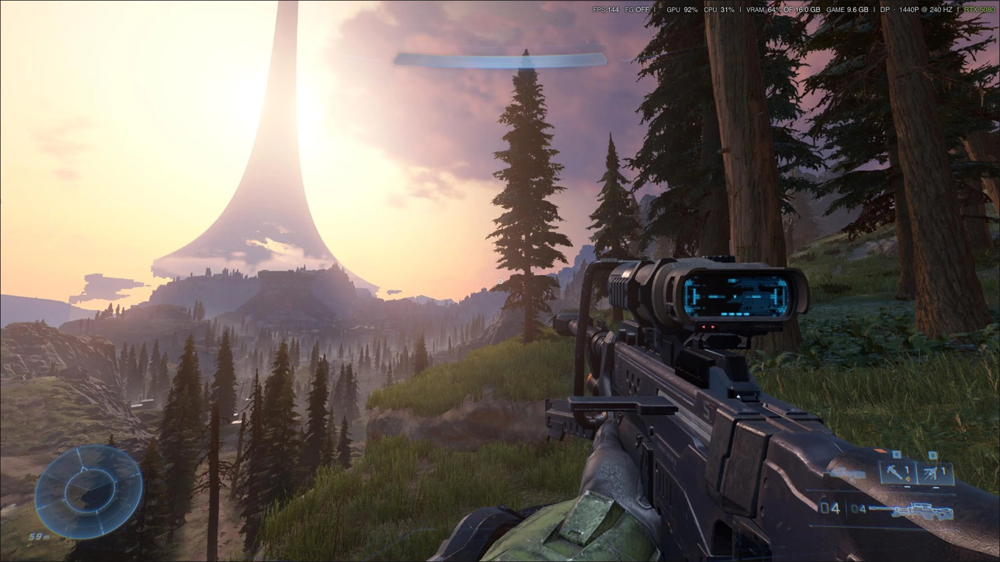
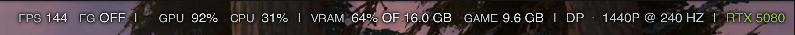
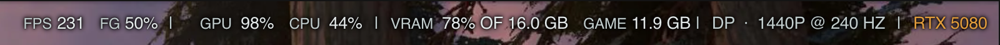
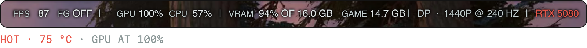
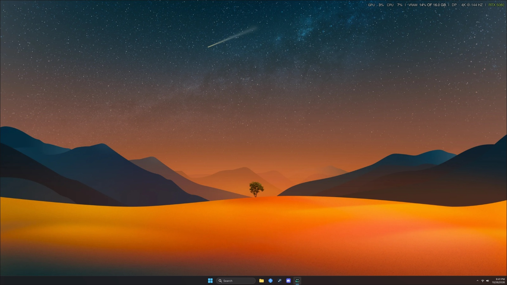
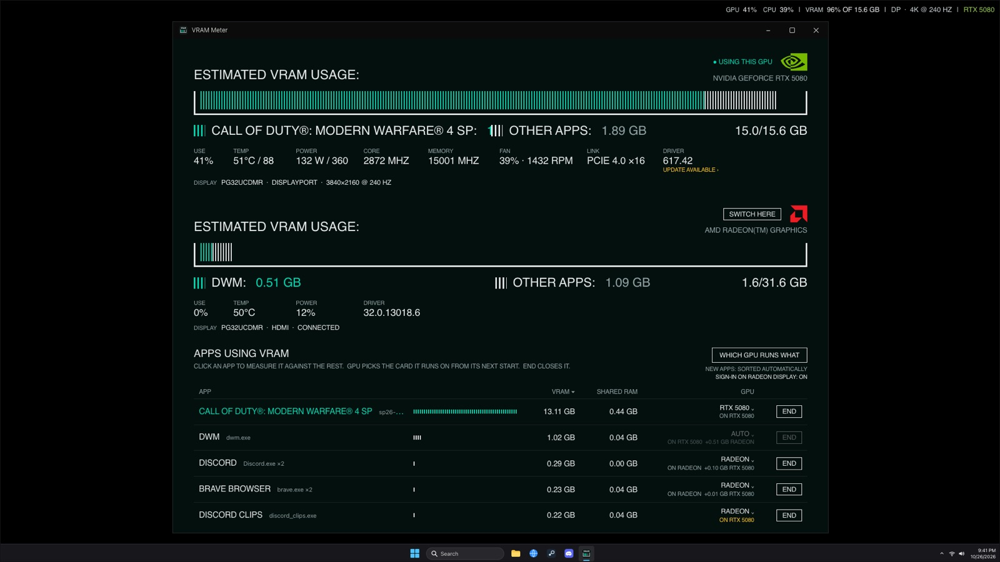

# VRAM Meter

**A clean in-game overlay for Windows.** Your frame rate, frame generation, GPU, CPU and VRAM in one line across
the top of the screen, readable over any game and never in the way.

**[Download](https://bartmatusiak.com/tech/vram-meter/)** · [bartmatusiak.com/tech/vram-meter](https://bartmatusiak.com/tech/vram-meter/) ·
Windows 10/11 (x64) · Free · No admin needed


<sub>Halo Infinite at 1440p, with the overlay in the top-right corner at its actual size.</sub>

I started VRAM Meter to see where my graphics card's memory was going. I built it for my own gaming PC, which has
two GPUs: a graphics card and the graphics built into the CPU. A game wants every last GB of the card, and Discord,
browsers and launchers don't need to be on it at all. Along the way the overlay turned into the part I use every
day: one line of numbers that tells me how a game is really running, without a cluttered panel over the action.

## The overlay

- **FPS and frame generation.** The game's frame rate, and how many of those frames are generated (DLSS Frame
  Generation, or FSR's in games with Reflex). 50% is 2× frame generation, OFF is none.
- **GPU, CPU and VRAM.** How busy each one is, how much of the card's memory is in use, and how much of it the game
  itself is holding.
- **The display.** Cable, resolution and refresh rate, so you can see at a glance you're actually getting 240 Hz.
- **Temperature at a glance.** The GPU's name is green while it's cool, turns amber around 65 °C and red past 75 °C.
- **Out of the way.** Drag it anywhere and it snaps to edges and corners, or hold Shift to place it exactly. Every
  display gets its own, it never steals focus from the game, and **Alt+O** shows and hides it.
- **Steady numbers.** Every figure has a fixed-width slot, so nothing jitters as the values change.

### Cool, warm, hot

The same line at three temperatures: green at 52 °C, amber at 66 °C with frame generation on, red at 75 °C with
the card at 100%.





With no game running it stays on the desktop too, down to GPU, CPU, VRAM, the display and the GPU.



## The VRAM meter

Open the window for the full picture: every app holding GPU memory, counted by what actually sits in the card's
own memory, with the biggest game measured against everything else. Click an app to measure it instead, or end one
you don't need right from the list. Under each meter are the GPU's vitals (use, temperature, power, clocks, fan,
PCIe link and driver, with a daily check for a newer NVIDIA driver) and every monitor plugged into it.



## Download

**[Download VRAM Meter](https://bartmatusiak.com/tech/vram-meter/)** for Windows 10 and 11 (x64), or get
`VramMeterSetup.exe` from the [latest release](https://github.com/bartmatusiak/vram-meter/releases/latest).

The setup installs it for you alone, so it needs no admin: in `%LOCALAPPDATA%\Programs\VRAM Meter`, on the Start menu,
and (your choice) on the desktop and starting with Windows in the tray. It's listed in Settings › Apps › Installed
apps, where it uninstalls. Running the setup again updates it and keeps your choices. `VramMeterSetup.exe /S`
installs silently.

It updates itself. When a new release is out, the window shows UPDATE TO and the tray menu shows Update to.
One click downloads the new setup, installs it over this one with your settings kept, and opens it again.

The release also has `VramMeter.exe` alone, one self-contained file that runs from anywhere with nothing installed.

Windows may show "Windows protected your PC" the first time, as it does for any app it hasn't seen many
downloads of: **More info › Run anyway**.

## More detail

FG is the share of frames made by frame generation (DLSS Frame Generation, or FSR's in a game with Reflex): 50%
is 2× frame generation, OFF is none, and `—` is a game without Reflex, which can't report it. AMD's driver-level
AFMF isn't counted. FPS needs your account in the Performance Log Users group (Game Bar's FPS "Request access"
adds it), then a sign-out and back in.

**The window** has a meter for each GPU: teal for the app you're measuring, white for everything else, out of the
card's total. Under it are the GPU's use, temperature, power, clocks, fan, PCIe link and driver, and the monitors
plugged into it.

Below that is every app holding GPU memory, counted by what actually sits in the GPU's own memory. You can:

- end an app (every one of its processes, after you confirm);
- choose the GPU it runs on, using Windows' own per-app setting, so the choice lasts;
- sort games onto the fast card and everything else onto the other GPU, by hand or as each new app shows up;
- with a monitor cabled to both GPUs, switch which GPU's display is main, with the monitor's input following, and
  start Windows on the built-in GPU's display so the apps that start with Windows land there (see below).

**The tray icon** is a small live meter. Hover for the figures, click for the window, and right-click for the
overlay, the display switch, Start with Windows, updates and Exit.

## The Windows issue

On some Windows builds (seen on Insider build 26300 with an RTX 5080 and a Ryzen's Radeon graphics),
Windows ignores the per-app GPU setting for apps opened from Start, the taskbar, a shortcut or at
sign-in: they all start on the GPU the main display is plugged into. Windows' own Graphics settings
page writes the very same registry entry VRAM Meter does, and it's ignored just the same; started some
other ways, the same app lands on the GPU it's set to. Until Windows fixes it, the display switch is
the workaround: apps start on the GPU whose display is main, and stay there when you switch.

## Safety

- No server: nothing outside the app can ask it to do anything. It uses the internet for two things. Every 6
  hours it asks GitHub for VRAM Meter's latest release, and installs one only when you click to; it checks the
  download against the SHA-256 GitHub publishes for it. Off in the tray menu. And once a
  day it asks NVIDIA's driver lookup (the one NVIDIA's download page uses) for the latest driver for
  an NVIDIA card, sending only the card's model (it asks for the 64-bit Windows driver, the same one for Windows 10 and 11), to show LATEST or UPDATE AVAILABLE under
  DRIVER. Off in the tray menu. AMD and Intel have no such lookup, so for their GPUs DRIVER shows a
  CHECK AMD › or CHECK INTEL › link to their own update tools instead; nothing is sent for those.
- Runs as you, never as administrator, so it can only end what you could end in Task Manager.
- Won't end Windows' own processes, services, anything Windows marks critical, or itself.
- Ends a process only after checking, through the same handle it ends it with, that it is the same
  .exe started at the same moment as the one listed, so a reused process ID can't be hit.
- Confirming needs a click: Cancel has the focus and Enter doesn't confirm.
- Writes only your own settings: its GPU choices (just the `GpuPreference` entry, keeping Auto HDR
  and the rest), its startup and uninstall entries, and, if you turn on starting on the built-in
  GPU's display, your saved display layout (turning it off or uninstalling puts the card's display
  back alone).

## Built with

| | |
|---|---|
| Language | C# on .NET 10 (WPF) |
| VRAM | Windows' GPU memory counters, per app and per GPU |
| GPU utilization | Windows' GPU engine counters, per app and per GPU |
| FPS | Event Tracing for Windows, read with Microsoft's TraceEvent library |
| Frame generation | NVIDIA Reflex's latency markers (PCLStats) |
| GPU vitals | NVML, NVIDIA's monitoring library, and DXGI |
| Monitors | DDC/CI, to switch a monitor's input |

## Building

Only for building VRAM Meter yourself: the setup and `VramMeter.exe` need nothing else installed, since the app
carries its own copy of .NET. Building needs the .NET 10 SDK (`winget install Microsoft.DotNet.SDK.10`, or `brew install dotnet` on a Mac) and, for the
setup, NSIS (`winget install NSIS.NSIS` / `brew install makensis`).

```
installer/build.sh
```

It builds `publish/VramMeter.exe` and `publish/VramMeterSetup.exe` (the version is the one in
`src/VramMeter.csproj`), on Windows (Git Bash), macOS or Linux.

### Installing from source

On Windows, no admin needed:

```
powershell -ExecutionPolicy Bypass -File install.ps1
```

It builds one self-contained `VramMeter.exe` into `%LOCALAPPDATA%\Programs\VRAM Meter`, adds it to the
Start menu and the desktop, starts it with Windows in the tray, and lists it in Settings › Apps ›
Installed apps (uninstall there, or `install.ps1 -Remove`). Rerun it after changing the source.

## Files

- `src/`: the app (WPF on .NET 10). `Gpus.cs` reads the GPUs (DirectX) and the GPU memory counters;
  `Processes.cs` names and ends processes; `GpuPreferences.cs` sets an app's GPU; `Sorter.cs` tells
  games from the rest; `Displays.cs` switches and lists displays; `GpuStats.cs` the GPUs' temperature, power, clocks and fan;
  `Load.cs` GPU and CPU use; `Overlay.cs` the overlay;
  `Tray.cs` the tray icon; `Updater.cs` updating itself; `MainWindow.xaml` the window.
- `src/make-icon.ps1`: draws `VramMeter.ico`.
- `docs/screenshots/`: the pictures above, drawn the way bartmatusiak.com draws them.
- `installer/`: the setup (`VramMeter.nsi`, NSIS) and `build.sh`, which builds the app and the setup.
- `install.ps1`: builds and installs from source; `-Remove` uninstalls.
- If something goes wrong, it's written to `%LOCALAPPDATA%\VRAM Meter\error.log`.

---

Made by [Bart Matusiak](https://bartmatusiak.com/). More at [bartmatusiak.com/tech](https://bartmatusiak.com/tech/).
